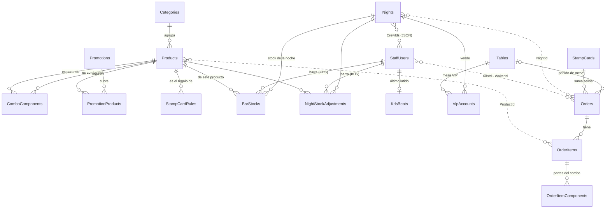
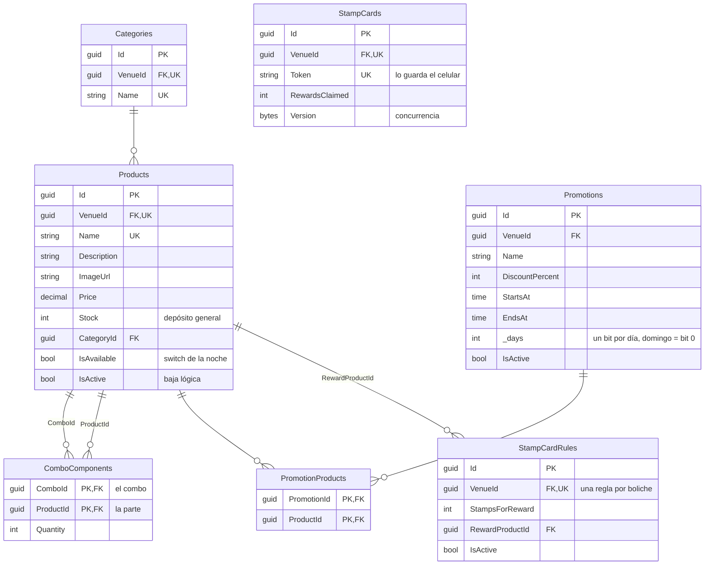
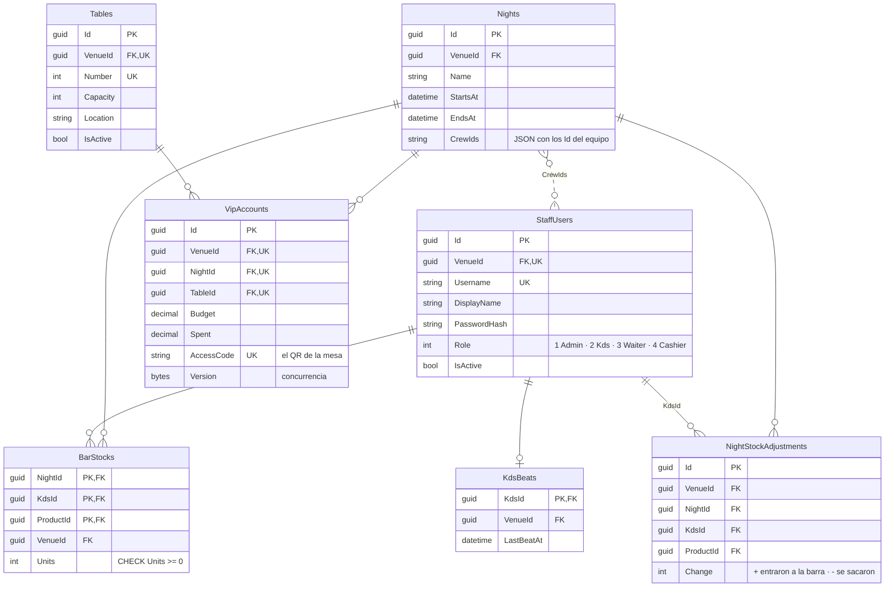
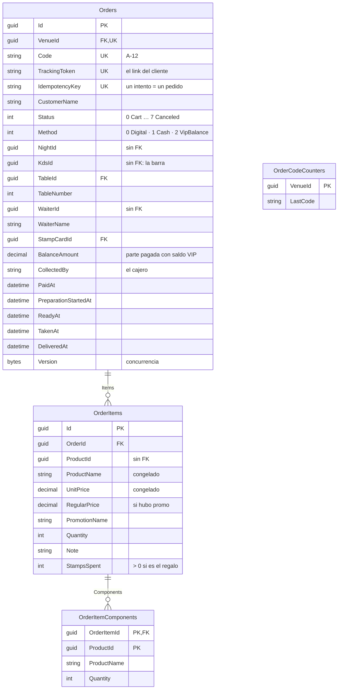

# 13 · Modelo de datos y migraciones

> Sale de `DrinkItDbContextModelSnapshot.cs` de `main` (última migración: `AddStampCards`).
> Si agregás una migración, el diagrama queda viejo: mirá el snapshot, que es la fuente de verdad.
>
> Los diagramas son **Mermaid**. VS Code los dibuja en la vista previa del Markdown
> (Cmd+Shift+V) si tenés la extensión "Markdown Preview Mermaid Support". GitHub los dibuja solo.

## Cómo leer los diagramas

| Símbolo | Significa |
|---|---|
| `\|\|--o{` línea **llena** | **Clave foránea real** en la base: SQL Server no deja guardar un Id que no existe. |
| `}o..o{` línea **punteada** | Un Id que apunta a otra tabla **sin** clave foránea. Es un dato y la base no lo controla. |
| `\|\|` / `\|o` | Exactamente uno / cero o uno (columna nullable). |
| `o{` | Cero o muchos. |
| `PK` `FK` `UK` | Clave primaria · clave foránea · forma parte de un índice único. |

**Dos cosas que no dibujo, para que se lea:**
- **`VenueId`** (multi-tenancy): 13 tablas tienen `VenueId` con FK a `Venues`. Las hijas
  (`ComboComponents`, `OrderItems`, `OrderItemComponents`, `PromotionProducts`) no lo tienen: lo
  heredan de su padre. `OrderCodeCounters` usa el `VenueId` como clave primaria, sin FK.
- **La auditoría:** casi todas tienen `CreatedAt`, `CreatedBy`, `LastModifiedAt` y
  `LastModifiedBy`. Las completa solo `AuditInterceptor` (Infrastructure/Persistence).

---

## 1 · El mapa completo (sin columnas)



**Las 19 tablas, por zona:**

| Zona | Tablas |
|---|---|
| Boliche | `Venues`, `OrderCodeCounters` |
| Carta | `Categories`, `Products`, `ComboComponents` |
| Promociones y sellos | `Promotions`, `PromotionProducts`, `StampCards`, `StampCardRules` |
| Personal | `StaffUsers`, `KdsBeats` |
| Noches y stock | `Nights`, `BarStocks`, `NightStockAdjustments` |
| Mesas VIP | `Tables`, `VipAccounts` |
| Pedidos | `Orders`, `OrderItems`, `OrderItemComponents` |

---

## 2 · Carta, promociones y sellos



- **Un combo es un `Product`** con filas en `ComboComponents`. No tiene stock propio: se vende
  desde el stock de sus partes.
- **Los sellos no se guardan:** se **calculan** de los pedidos entregados de la tarjeta
  (`StampCardRepositories.GetBalanceAsync`). Por eso `StampCards` sólo guarda los canjes.

---

## 3 · Personal, noches, stock y mesas



- **Una barra es un `StaffUser` con rol KDS.** No hay tabla `BarStations`: `KdsId` es el Id de
  ese usuario.
- **`BarStocks` tiene clave compuesta** (noche + barra + producto): una fila por cada producto
  que se cargó en cada barra esa noche.
- **El equipo de la noche (`CrewIds`)** es una lista de Ids guardada como JSON en una sola
  columna. Por eso no hay FK, y por eso se lee con `EF.Property<List<Guid>>(night, "_crewIds")`.
- **`VipAccounts` es la mesa VIP *vendida en una noche***: el índice único
  `(VenueId, NightId, TableId)` impide vender dos veces la misma mesa la misma noche.

---

## 4 · Pedidos



- **`Status`** se guarda como número: `0 Cart · 1 AwaitingPayment · 2 Paid · 3 Queued ·
  4 InPreparation · 5 Ready · 6 Delivered · 7 Canceled`. Por eso un estado nuevo va **al final**
  (consigna D): si lo metés en el medio, los pedidos guardados cambian de estado.
- **`OrderItems` congela nombre y precio.** Si mañana cambia el precio o se da de baja el
  producto, el pedido y el reporte siguen diciendo lo que se cobró. Por eso `ProductId` no tiene
  FK.
- **`Code` es único por boliche**, no global: índice `(VenueId, Code)`. Lo genera
  `OrderCodeCounters`, con una fila por boliche.
- **`Version`** (en `Orders`, `VipAccounts` y `StampCards`) es el token de concurrencia: si dos
  personas guardan el mismo registro a la vez, la segunda falla en vez de pisar a la primera.

---

## 5 · Migraciones: crear, aplicar, deshacer y borrar

Todos los comandos van desde la **raíz del repo**, y todos llevan los mismos dos parámetros:

```bash
--project backend/src/DrinkIt.Infrastructure --startup-project backend/src/DrinkIt.Api
```

Si `dotnet ef` dice "no se encontró el comando", corré una vez `dotnet tool restore`.

### Crear una migración

```bash
dotnet ef migrations add AddProductIsFeatured \
  --project backend/src/DrinkIt.Infrastructure \
  --startup-project backend/src/DrinkIt.Api \
  --output-dir Persistence/Migrations
```

- **Antes:** la propiedad está en la entidad **y** mapeada en su `XxxConfiguration`. Para un
  `bool` nuevo en una tabla con datos, usá `defaultValue`, o las filas viejas no tienen valor.
- **Después:** abrí el `<fecha>_AddProductIsFeatured.cs`. **El `Up()` tiene que tener sólo lo
  tuyo.** Si aparece algo más (como el `MaxOrderPerKds` que se coló en `OnHoldOrder`), es un
  cambio viejo que quedó sin migrar: frená y limpiá antes.
- **Si el `Up()` sale vacío** (como `OnFavoriteProduct1`), no había nada nuevo: borrala con
  `migrations remove`.

### Aplicarla

Sola: en Development, la API aplica las migraciones pendientes **al arrancar**. A mano:

```bash
dotnet ef database update \
  --project backend/src/DrinkIt.Infrastructure \
  --startup-project backend/src/DrinkIt.Api
```

### Ver en qué estado está

```bash
dotnet ef migrations list \
  --project backend/src/DrinkIt.Infrastructure \
  --startup-project backend/src/DrinkIt.Api
```

Las que no se aplicaron dicen `(Pending)`. Y para saber si cambiaste el modelo sin migrar:

```bash
dotnet ef migrations has-pending-model-changes \
  --project backend/src/DrinkIt.Infrastructure \
  --startup-project backend/src/DrinkIt.Api
```

### Deshacerla (ya está aplicada en la base)

Volvés la base a **la migración anterior**, por nombre. Eso corre el `Down()` de todas las que
vienen después:

```bash
dotnet ef database update AddStampCards \
  --project backend/src/DrinkIt.Infrastructure \
  --startup-project backend/src/DrinkIt.Api
```

- **Cortá la API antes** (Ctrl+C).
- **Los archivos de la migración tienen que existir** cuando lo corrés, porque el `Down()` está
  adentro. Si ya los borraste, no hay cómo deshacerla.
- Para volver la base **a cero** (borra todo): `dotnet ef database update 0 …`.

### Borrarla (los archivos)

```bash
dotnet ef migrations remove \
  --project backend/src/DrinkIt.Infrastructure \
  --startup-project backend/src/DrinkIt.Api
```

- Borra **la última** migración y deja el snapshot como estaba antes.
- **Si ya está aplicada, primero deshacela** (el paso de arriba). Si no, `remove` falla.
- Corrélo **una vez por migración**: cada vez borra sólo la última.

### La receta que usamos para limpiar una consigna con migración

1. Cortá la API.
2. `dotnet ef database update <la migración anterior a la tuya>` → la base vuelve atrás.
3. `dotnet ef migrations remove` → se borran los archivos y se arregla el snapshot.
4. Recién ahí sacás la propiedad de la entidad y de su `XxxConfiguration`.
5. `dotnet ef migrations has-pending-model-changes` tiene que decir
   "No changes have been made to the model since the last migration".

**El orden importa:** si sacás la propiedad antes del paso 3, el modelo ya no coincide con la
migración y el `remove` falla o deja el snapshot mal.
